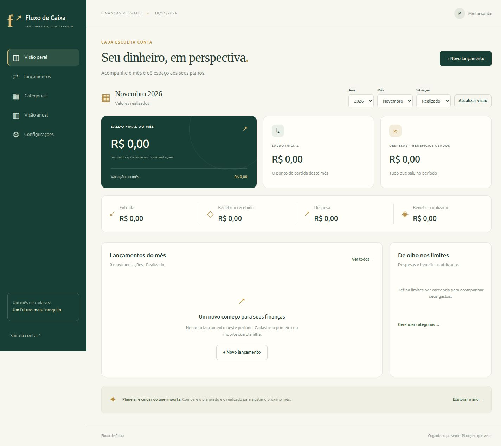
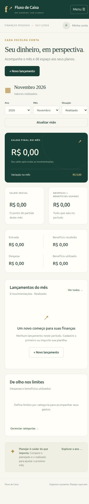

# Verificação da entrega

Verificado em 10/11/2026, com Ruby 3.4.8 e Rails 8.1.4.1:

- `bin/rails test`: **46 testes, 300 assertions, nenhuma falha ou erro**.
- `bin/rails zeitwerk:check`: todas as classes carregaram corretamente.
- Migrations executadas em SQLite de desenvolvimento, teste e produção isolada.
- `RAILS_ENV=production SECRET_KEY_BASE_DUMMY=1 bin/rails assets:precompile`: compilação concluída.
- Em produção, requisição HTTPS sem sessão redirecionou ao login.
- Navegador: login, formulário e criação de 10 parcelas iniciadas em novembro de 2026, com criação automática de 2027 e divisão exata dos centavos.
- Interface conferida em 1440 px e 390 px. Menu móvel funcional e nenhuma rolagem horizontal no dashboard.
- As verificações visuais usaram uma base temporária isolada, não distribuída no pacote.

Verificação da referência e limites da entrega:

- A referência real foi analisada posteriormente, com ano 2027 escolhido explicitamente pelo usuário.
- Apuração independente diretamente no XML: 267 lançamentos (66 realizados e 201 planejados), 44 grupos e 84 limites. Prévia e banco em memória coincidiram em quantidades e totais por mês, situação e tipo; os 24 fechamentos mensais também foram conferidos.
- Identificadas 243 datas inferidas e 24 datas com ano ajustado. Os três lançamentos avulsos das linhas 53–55 do resumo e as 12 células com conteúdo fora da tabela em dezembro são destacados, sem importação automática.
- Nenhum dado financeiro pessoal foi persistido na base de uso. A validação utilizou SQLite em memória e não alterou o XLSX original.
- Os testes de regressão reproduzem apenas a estrutura e usam dados sintéticos.
- Dockerfile fornecido, mas build não executado por ausência de permissão de acesso ao daemon Docker.
- Não foi feito deploy público.

